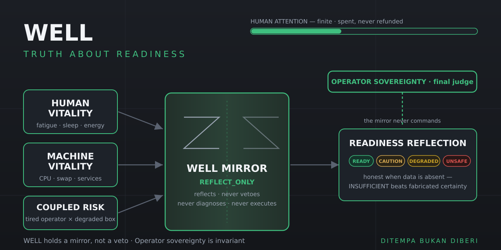

<!-- SOT-MANIFEST
owner: Muhammad Arif bin Fazil (F13 SOVEREIGN)
federation_release: v2026.09.13
last_verified: 2026-09-13T06:32:00Z
live_commit: 4e4e04c
live_health: degraded (OBS 2026-09-13) — REFLECT_ONLY, no autonomy escalation
tools_live: 31 (canonical, live-witnessed via :18083/health)
authority_ceiling: REFLECT_ONLY
apex_zen: A2A delegates ⊥ MCP equips ⊥ ACT mutates ⊥ arifOS governs ⊥ F13 decides
honesty: H-WELL is SELF_REPORT/AGED until biometric inject; M-WELL machine_state.json is separate
mesh: thermal observes KVM8 organs + KVM4 LiteLLM/OpenClaw + KVM2 witness fork — not extra judges
truth_rule: live :18083/health + tools/list beat any static count in prose
holds: biometric telemetry never on public or extended A2A cards
-->

<p align="center">
  
</p>

# WELL

### Truth about readiness.

**WELL is the arifOS federation's vitality organ.** It reflects human, machine, and coupled readiness as evidence — labelled with freshness and honesty, never dressed up as certainty — and returns every judgment to the human.

Most failures announce themselves early: fatigue hides as confidence, degradation hides as "mostly working", burnout hides as discipline. WELL makes the slow drift visible before it becomes the incident.

[30-second proof](#30-second-proof) · [What it does](#what-it-does) · [Current verified state](#current-verified-state) · [Known gaps](#evidence--known-gaps) · [Security](./SECURITY.md)

[](./.github/workflows/agentic-ci.yml)
[](https://modelcontextprotocol.io)
[](#the-invariant)
[](./SECURITY.md)
[](./LICENSE)

### The invariant

> **WELL holds a mirror, not a veto. Operator sovereignty is invariant.**
> WELL informs. arifOS judges. Arif decides.

**What WELL is not:** not a medical device · not a diagnosis or therapy · not a judge (arifOS judges) · not an executor (A-FORGE executes) · not a veto. Biometric telemetry never appears on public or extended A2A surfaces.

| Audience | What you get |
|---|---|
| **Human** | An honest readiness mirror — sleep, fatigue, energy and machine pressure, with the confidence and age of every reading spelled out |
| **Agent / A2A** | MCP tools on `:18083` — readiness signals with honesty labels, consent-scoped ingestion, `REFLECT_ONLY` ceiling (you get evidence, never authority) |
| **Developer** | A Python FastMCP service you can run locally, a machine-telemetry collector, and remediation advice that routes to A-FORGE instead of running itself |
| **Auditor** | [Current verified state](#current-verified-state) · [`docs/GOVERNANCE.md`](./docs/GOVERNANCE.md) · [`docs/BOUNDARY.md`](./docs/BOUNDARY.md) · [`llms.txt`](./llms.txt) · honesty doctrine below |

Live: `https://well.arif-fazil.com` · MCP `:18083` · sister organs [arifOS](https://github.com/ariffazil/arifOS) · [A-FORGE](https://github.com/ariffazil/A-FORGE) · [arifFlow](https://github.com/ariffazil/arifFLOW)

---

## What works today

- **Machine substrate telemetry, collected and checked continuously.** The `well-machine-telemetry.timer` collector feeds `machine_state.json`; the mirror reports its freshness band instead of pretending old data is current (observed 2026-10-16).
- **Honest degradation over fabricated certainty.** When sovereign biometric state is unknown, the health surface reports `INSUFFICIENT_DATA` with a required banner and refuses to invent a `well_score` (observed 2026-10-16).
- **A live, governed MCP surface** — readiness assessment, machine diagnostics, dignity/consent guard, substrate classification (`curl :18083/tools`).
- **Remediation advice that does not self-execute.** WELL recommends commands with a risk class; A-FORGE executes them under verdict — the ceiling is enforced by role, not by promise.

## What is not yet proven

- **A live human biometric feed.** H-WELL readings are SELF_REPORT / AGED until a sovereign biometric inject or Google Fit OAuth lands ([`scripts/biometric_inject.sh`](./scripts/biometric_inject.sh)) — currently blocked on exactly that (see [state](#current-verified-state)).
- **W3 tri-witness** — reported UNMEASURED by the kernel apex scalars; do not cite a W3 for WELL.
- **Domain data readiness** — INSUFFICIENT_DATA: readiness claims are not yet backed by a multi-sample dataset.
- **Independent verification.** Everything above is runtime self-measurement or maintainer-observed; no external reviewer has audited WELL.
- **Stranger reproduction** of the documented run path.

Every row, with evidence and risk: [Evidence & known gaps](#evidence--known-gaps). We publish what passed, what failed, and what remains unknown — honest degradation is a feature that prevents false confidence.

---

## 30-second proof

One read-only command against the public surface:

```bash
curl -s https://well.arif-fazil.com/health | jq .
```

Expected shape: a small JSON object with `status`, `organ`, `version`. The current values (including a `degraded` status when human data is stale — by design) are quoted in [Current verified state](#current-verified-state). On the box itself, `curl -s http://127.0.0.1:18083/health | jq .honesty_banner` shows the honesty banner.

---

## What it does

WELL compresses into four user jobs:

1. **Mirror human readiness (H-WELL).** Sleep, fatigue, energy, circadian alignment and cognitive load — every reading carrying its source type, age and confidence. Never a clinical claim.
2. **Diagnose the machine substrate (M-WELL).** CPU, RAM, swap, disk, PSI, zombies, Docker and service health from collected `/proc` telemetry, with concrete remediation commands and a risk class.
3. **Reflect coupled risk (C-WELL).** The dangerous state is rarely one axis: a tired operator on a degraded box compounds. The coupled plane reflects that interaction.
4. **Guard dignity and classify substrates (U-WELL).** Consent-scoped ingestion (biometric scopes default OFF), privacy floors on every surface, and substrate classification that keeps humans and machines ontologically distinct.

Full tool inventory: [`docs/WELL_TOOL_SURFACE.md`](./docs/WELL_TOOL_SURFACE.md) · live list: `curl -s http://127.0.0.1:18083/tools`.

---

## Current verified state

**Observed at: 2026-10-16T09:06:37Z** — method: `curl http://127.0.0.1:18083/health` and `curl http://127.0.0.1:18083/tools` on the production host.

- Organ status: `degraded` · authority ceiling `REFLECT_ONLY` · floors violated: none
- Tool surface: **10 tools exposed** (`well_machine_diagnose`, `well_machine_recommend`, `well_classify_substrate`, `well_trace_lineage`, `well_assess_homeostasis`, `well_check_repair`, `well_validate_vitality`, `well_assess_reliability`, `well_guard_dignity`, `well_registry_status`)
- Machine substrate: `healthy`, freshness `FRESH` (age ≈ 295 s at probe; collector `well-machine-telemetry.timer`)
- Human substrate: `INSUFFICIENT_DATA`, freshness `EXPIRED` (≈ 5.9 h old) — blocked on sovereign biometric inject or Google Fit OAuth
- Honesty banner: `INSUFFICIENT — sovereign biometric state unknown. Inject or sensor feed required.`
- W3: `UNMEASURED` · domain data readiness: `INSUFFICIENT_DATA` · well signal: `WELL_HOLD`

Dynamic state is generated by probe. If this section conflicts with the live endpoint, the endpoint wins.

> **Honesty doctrine (standing, not state):** H-WELL is SELF_REPORT/AGED until biometric inject. When data is absent, stale or mock, WELL degrades the claim — freshness bands (`FRESH`/`STALE`/`EXPIRED`) and source typing travel with every reading. It never extrapolates silence into a score.

---

## Concepts (compressed)

**Five mirrors, one gate.**

| Mirror | Reflects | Never does |
|---|---|---|
| **H-WELL** | Human vitality — sleep, fatigue, energy, dignity, consent | diagnose, prescribe |
| **M-WELL** | Machine substrate — CPU, RAM, swap, disk, PSI, services, Docker | restart or mutate anything |
| **G-WELL** | Governance coherence — autonomic and floor-compliance signals | issue verdicts |
| **C-WELL** | Coupled risk — human × machine interaction | flatten one into the other |
| **U-WELL** | Substrate classification and vitality for any substrate | category error, false equivalence |

**Boundary (from the live health surface):** *Not diagnosis. Not therapy. Reflective readiness only. Arif remains final judge.*

**Consent and privacy (F1 AMANAH).** Biometric and personal-health data stays on sovereign infrastructure; consent scopes default to OFF and are granted explicitly; biometric telemetry is never published on public or extended A2A cards.

Deeper material: [`docs/README-FULL.md`](./docs/README-FULL.md) · [`docs/GOVERNANCE.md`](./docs/GOVERNANCE.md) · [`docs/METRIC_CARDS.md`](./docs/METRIC_CARDS.md) · [`docs/BOUNDARY.md`](./docs/BOUNDARY.md) · [`docs/WELL_ARIFOS_CONTRACT.md`](./docs/WELL_ARIFOS_CONTRACT.md)

---

## Evidence & known gaps

Each row names its own gap; repairing a claim by substituting a stronger one is worse than the stale claim it replaced.

| Gap | Risk | Status |
|---|---|---|
| Live human biometric feed | Human readings stay SELF_REPORT/AGED; fatigue signals can lag by hours | **Open** — blocked on sovereign biometric inject or Google Fit OAuth ([`scripts/biometric_inject.sh`](./scripts/biometric_inject.sh)) |
| W3 tri-witness | No coupled witness scalar can be cited for WELL | **UNMEASURED** — kernel apex scalars report `null`; do not substitute a computed value |
| Domain data readiness | Readiness claims lack a multi-sample dataset behind them | **INSUFFICIENT_DATA** (observed 2026-10-16) |
| Independent audit | Self-measurement is the only witness so far | **Open** — no external reviewer has published findings |
| Stranger reproducibility | Run path documented here is maintainer-verified only | **Open** |
| Tool-surface documentation drift | `.well-known/mcp/server.json` and the SOT-MANIFEST header carry older tool counts (`22`, `31`) than the live surface | **Open** — live `:18083/tools` wins (truth rule); docs to be re-stamped by probe |

Closed historical rows: [`docs/archive/`](./docs/archive/) (pre-doctrine README preserved at [`docs/archive/README-2026-10-16-pre-doctrine.md`](./docs/archive/README-2026-10-16-pre-doctrine.md)).

---

## Development

```bash
git clone https://github.com/ariffazil/WELL.git
cd WELL
make install        # uv sync --frozen
make test           # pytest
make lint           # ruff
make health         # probe :18083
```

Run the service the way production does (systemd unit `well.service` pins `PORT=18083`, `HOST=127.0.0.1`):

```bash
PORT=18083 HOST=127.0.0.1 .venv/bin/python3 server.py
```

### Operational gates

| Workflow | What it guards |
|---|---|
| [agentic-ci](./.github/workflows/agentic-ci.yml) | build + test |
| [governance-gate](./.github/workflows/governance-gate.yml) | governance contract |
| [repo-routing-validation](./.github/workflows/repo-routing-validation.yml) | repo routing policy |
| [repo-hygiene-weekly](./.github/workflows/repo-hygiene-weekly.yml) | hygiene sweep |

See [`CONTRIBUTING.md`](./CONTRIBUTING.md) and [`CODEOWNERS`](./.github/CODEOWNERS).

---

## Security & license

Threat model and disclosure policy: [`SECURITY.md`](./SECURITY.md). Dignity floor: biometric and personal-health data remains strictly confidential on sovereign infrastructure; report any leak as a security incident.

**AGPL-3.0** ([`LICENSE`](./LICENSE)) — when deployed over a network, the complete source code must be made available to all users interacting with the service.

---

*Revision 2026-10-16 — restructured under AGENTIC-README-DOCTRINE v1 (attention layer for humans, agents and institutions; dynamic state probed and dated, never hand-carried). Pre-doctrine text preserved verbatim in [`docs/archive/README-2026-10-16-pre-doctrine.md`](./docs/archive/README-2026-10-16-pre-doctrine.md).*

**DITEMPA BUKAN DIBERI** — Forged, Not Given.

Built by Muhammad Arif bin Fazil.

<!-- FEDERATION-STANDARD v2026-10-15 START :: 333-AGI audit :: source: organs.yaml + git + live probes :: regenerate: re-run audit -->
## 🔗 Federation Identity (auto-audit 2026-10-15)
| Field | Value |
|---|---|
| Organ | `well` · CORE · domain_evidence |
| Ports | 18083 |
| Unit | well.service |
| Authority ceiling | REFLECT_ONLY |
| Live (SOT probe @audit) | UP |
| Repo HEAD @audit | `9ec95ab 2026-10-08` |
| Public MCP | https://well.arif-fazil.com/mcp |
| Rollback | — |
| Flow graph | [FEDERATION.md](https://github.com/ariffazil/AAA/blob/main/FEDERATION.md) — peta semua organ + repo |
<!-- FEDERATION-STANDARD v2026-10-15 END -->
