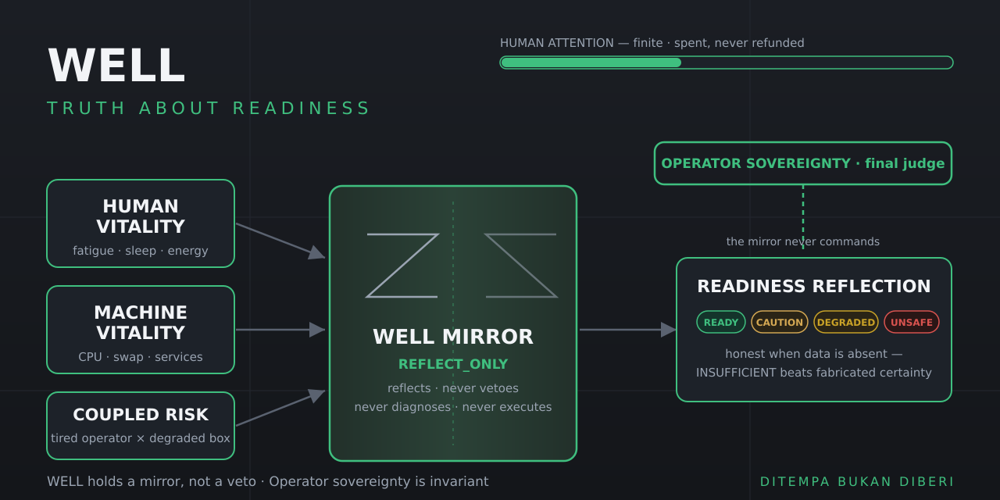

<!-- SOT-MANIFEST
owner: Muhammad Arif bin Fazil (F13 SOVEREIGN)
federation_release: v2026.11.18
last_verified: 2026-11-18T07:32:07Z
source_commit: 02465de
live_commit: b7a1b9a (v2026-11-18 runtime on host)
live_health: degraded (OBS 2026-11-18) — REFLECT_ONLY, no autonomy escalation (SELF_REPORT / EXPIRED)
tools_live: 10 (canonical, live-witnessed via :18083 MCP tools/list, OBS 2026-11-18: well_assess_homeostasis, well_assess_reliability, well_check_repair, well_classify_substrate, well_guard_dignity, well_machine_diagnose, well_machine_recommend, well_registry_status, well_trace_lineage, well_validate_vitality)
authority_ceiling: REFLECT_ONLY
apex_zen: A2A delegates ⊥ MCP equips ⊥ ACT mutates ⊥ arifOS governs ⊥ F13 decides
honesty: H-WELL is OPERATOR_REPORTED (SELF_REPORT/EXPIRED 5.9h) until wearable/biometric inject; M-WELL machine_state.json is separate
mesh: thermal observes KVM8 organs + KVM4 LiteLLM/OpenClaw/agentic stack — not extra judges
truth_rule: live :18083/health + MCP tools/list beat any static count in prose
holds: biometric telemetry never on public or extended A2A cards
-->

<p align="center">
  
</p>

# WELL

### Truth about readiness.

<!-- ═══════════════════════════════════════════════════════════════════════ -->
<!-- LANE 1: THE 60-SECOND HUMAN HORIZON                                     -->
<!-- ═══════════════════════════════════════════════════════════════════════ -->

## What is this?
WELL is a private readiness mirror that reflects human fatigue, sleep debt, and machine pressure so an operator can see when their physical capacity is depleted.

## Why does it exist?
Fatigue hides as confidence, burnout hides as discipline, and late-night venting to an AI can fool the brain into believing real-world problems are solved. WELL makes the slow physical drift visible before it becomes a personal or operational collapse.

## Who bears the consequence if this fails?
The human operator. A server can be rebooted; an exhausted human bears the real-world health, relational, and financial consequences of burning out.

## What does it protect?
Human dignity (*maruah*), physical vitality, and absolute personal privacy.

## What WELL will never do
* **NEVER secretly report or alert anyone:** WELL will never alert an employer, family member, friend, or third party behind your back.
* **NEVER diagnose illness:** WELL does not diagnose depression, anxiety, or medical conditions from typing habits, late-night messages, or tone of voice.
* **NEVER act as a corporate nanny (*bibik*):** WELL will never lock your account, lecture you, or inject patronizing pop-ups demanding proof of rest.
* **NEVER combine human worth into a single score:** WELL treats human vitality and machine uptime as ontologically separate.

## Human First
This system exists to serve humans. Humans remain sovereign.  
The system may recommend.  
The system may assist.  
The system may execute permitted actions.  
**The system may never become authority over a human.**

## Reality Connection
* **Reality:** Sleep. Biology. Circadian rhythm. Autonomic nervous system limits.
* **Failure Cost:** Chronic illness, burnout, broken relationships, cognitive collapse.
* **Doctrine:** *Teks bukan manusia. Sensor bukan diagnosis. Lega bukan selesai.*

---

<!-- ═══════════════════════════════════════════════════════════════════════ -->
<!-- LANE 2: MACHINE-EXECUTABLE CONTRACT                                     -->
<!-- ═══════════════════════════════════════════════════════════════════════ -->

```yaml
organ:
  name: WELL
  purpose: consequence-sensing-mirror
  repository: https://github.com/ariffazil/WELL

authority:
  owner: Muhammad Arif bin Fazil (F13 SOVEREIGN)
  ceiling: REFLECT_ONLY
  can_propose: yes
  can_verify: yes
  can_authorize: no
  can_execute: no
  can_witness: yes
  can_record: no

boundaries:
  self_authorization: prohibited
  silent_external_contact: prohibited
  silent_escalation: prohibited
  surveillance: prohibited
  diagnosis_from_text: prohibited
  claim_beyond_evidence: prohibited

execution:
  authorization_required: true
  approved_executor: A-FORGE
  receipt_required: true
  outcome_witness_required: true
  human_acceptance_separate: true

truth:
  current_state_source: http://127.0.0.1:18083/health
  evidence_source: machine_state.json
  freshness_rule: live_health_beats_static_prose
  unknown_behavior: fail_closed

status:
  proven: machine_substrate_telemetry_and_honesty_degradation
  partial: human_vitality_mirror
  target: user_led_handoff_integration
  research: wearable_biometric_calibration
```

---

### The invariant

> **WELL holds a mirror, not a veto. Operator sovereignty is invariant.**
> WELL informs. arifOS judges. Arif decides.

[30-second proof](#30-second-proof) · [What it does](#what-it-does) · [Current verified state](#current-verified-state) · [Known gaps](#evidence--known-gaps) · [Security](./SECURITY.md)

[](./.github/workflows/agentic-ci.yml)
[](https://modelcontextprotocol.io)
[](#the-invariant)
[](./SECURITY.md)
[](./LICENSE)

| Audience | What you get |
|---|---|
| **Human** | An honest readiness mirror — sleep, fatigue, energy and machine pressure, with the confidence and age of every reading spelled out |
| **Agent / A2A** | MCP tools on `:18083` — readiness signals with honesty labels, consent-scoped ingestion, `REFLECT_ONLY` ceiling (you get evidence, never authority) |
| **Developer** | A Python FastMCP service you can run locally, a machine-telemetry collector, and remediation advice that routes to A-FORGE instead of running itself |
| **Auditor** | [Current verified state](#current-verified-state) · [`docs/GOVERNANCE.md`](./docs/GOVERNANCE.md) · [`docs/BOUNDARY.md`](./docs/BOUNDARY.md) · [`llms.txt`](./llms.txt) · honesty doctrine below |

Live: `https://well.arif-fazil.com` · MCP `:18083` · sister organs [arifOS](https://github.com/ariffazil/arifOS) · [A-FORGE](https://github.com/ariffazil/A-FORGE) · [arifFlow](https://github.com/ariffazil/arifFLOW) · [FRAME](https://github.com/ariffazil/FRAME) · [CHRON](https://github.com/ariffazil/CHRON)

---

## What works today

- **Machine substrate telemetry, collected and checked continuously.** The `well-machine-telemetry.timer` collector feeds `machine_state.json`; the mirror reports its freshness band (`FRESH` on host probe) instead of pretending old data is current.
- **Honest degradation over fabricated certainty.** When verified sensor biometrics are absent, `has_verified_telemetry` stays `false`, the health surface reports `status: degraded` (`OPERATOR_REPORTED` / `SELF_REPORT`), and refuses to invent a synthetic `well_score`.
- **A live, governed MCP surface** — 10 Streamable HTTP MCP tools on `:18083/mcp` covering readiness assessment, machine diagnostics, dignity/consent guard, and substrate classification.
- **Remediation advice that does not self-execute.** WELL recommends commands with a risk class; A-FORGE executes them under verdict — the ceiling is enforced by role, not by promise.

## What is not yet proven

- **Verified wearable biometric feed.** `has_verified_telemetry` is `false`; H-WELL readings are `OPERATOR_REPORTED` (`SELF_REPORT`, `EXPIRED` at 5.9 h in the 2026-11-18 probe) until sovereign biometric inject or Google Fit OAuth lands ([`scripts/biometric_inject.sh`](./scripts/biometric_inject.sh)).
- **Hardware-coupled sample dataset.** `well_score` remains `0` and sensor-backed readiness lacks a longitudinal sample dataset behind it.
- **Independent verification.** Everything above is runtime self-measurement or maintainer-observed; no external reviewer has audited WELL.
- **Stranger reproduction** of the documented run path.

Every row, with evidence and risk: [Evidence & known gaps](#evidence--known-gaps). We publish what passed, what failed, and what remains unknown — honest degradation is a feature that prevents false confidence.

---

## 30-second proof

One read-only command against the public surface:

```bash
curl -s https://well.arif-fazil.com/health | jq .
```

Expected shape: a small JSON object with `status`, `organ`, `version`. The current values (including a `degraded` status when human data is stale — by design) are quoted in [Current verified state](#current-verified-state). On the box itself, `curl -s http://127.0.0.1:18083/health | jq .honesty_banner` shows the honesty banner.

---

## What it does

WELL compresses into four user jobs:

1. **Mirror human readiness (H-WELL).** Sleep, fatigue, energy, circadian alignment and cognitive load — every reading carrying its source type, age and confidence. Never a clinical claim.
2. **Diagnose the machine substrate (M-WELL).** CPU, RAM, swap, disk, PSI, zombies, Docker and service health from collected `/proc` telemetry, with concrete remediation commands and a risk class.
3. **Reflect coupled risk (C-WELL).** The dangerous state is rarely one axis: a tired operator on a degraded box compounds. The coupled plane reflects that interaction.
4. **Guard dignity and classify substrates (U-WELL).** Consent-scoped ingestion (biometric scopes default OFF), privacy floors on every surface, and substrate classification that keeps humans and machines ontologically distinct.

Full tool inventory: [`docs/WELL_TOOL_SURFACE.md`](./docs/WELL_TOOL_SURFACE.md) · live list: `curl -s http://127.0.0.1:18083/tools`.

---

## Current verified state

**Observed at: 2026-11-18T07:32:07Z** — method: `curl http://127.0.0.1:18083/health`, `curl https://well.arif-fazil.com/health`, and Streamable HTTP MCP `tools/list` on the production host.

- Organ status: `degraded` (`v2026-11-18`, live commit `b7a1b9a`) · authority ceiling `REFLECT_ONLY` · floors violated: none
- Tool surface: **10 tools exposed** (`well_machine_diagnose`, `well_machine_recommend`, `well_classify_substrate`, `well_trace_lineage`, `well_assess_homeostasis`, `well_check_repair`, `well_validate_vitality`, `well_assess_reliability`, `well_guard_dignity`, `well_registry_status`)
- Machine substrate: `healthy`, freshness `FRESH` (`age_seconds=68.2` at probe; collector `well-machine-telemetry.timer`)
- Human substrate: `OPERATOR_REPORTED`, honesty `SELF_REPORT`, freshness `EXPIRED` (`age_hours=5.9`) · `has_verified_telemetry=false` · `well_score=0` (blocked on sovereign biometric inject or Google Fit OAuth)
- Honesty banner: `SELF-REPORT -- sovereign inject / presence assert. Not wearable sensor telemetry.`
- Apex scalars on `:18083/health`: `G=0.5184`, `C_dark=0.117`, `W3=0.4622`, `h=0.9122`, `QDF=0.4577` (all reported `MEASURED`) · `domain_data_readiness=OPERATOR_REPORTED` · `well_signal=WELL_OPERATOR_PRESENT`
- Public health endpoint: `https://well.arif-fazil.com/health` (`200`, redacted summary `{"status":"degraded","organ":"WELL","version":"v2026-11-18"}`)

Dynamic state is generated by probe. If this section conflicts with the live endpoint, the endpoint wins.

> **Honesty doctrine (standing, not state):** H-WELL is SELF_REPORT/AGED until biometric inject. When data is absent, stale or mock, WELL degrades the claim — freshness bands (`FRESH`/`STALE`/`EXPIRED`) and source typing travel with every reading. It never extrapolates silence into a score.

---

## Concepts (compressed)

**Five mirrors, one gate.**

| Mirror | Reflects | Never does |
|---|---|---|
| **H-WELL** | Human vitality — sleep, fatigue, energy, dignity, consent | diagnose, prescribe |
| **M-WELL** | Machine substrate — CPU, RAM, swap, disk, PSI, services, Docker | restart or mutate anything |
| **G-WELL** | Governance coherence — autonomic and floor-compliance signals | issue verdicts |
| **C-WELL** | Coupled risk — human × machine interaction | flatten one into the other |
| **U-WELL** | Substrate classification and vitality for any substrate | category error, false equivalence |

**Boundary (from the live health surface):** *Not diagnosis. Not therapy. Reflective readiness only. Arif remains final judge.*

**Consent and privacy (F1 AMANAH).** Biometric and personal-health data stays on sovereign infrastructure; consent scopes default to OFF and are granted explicitly; biometric telemetry is never published on public or extended A2A cards.

Deeper material: [`docs/README-FULL.md`](./docs/README-FULL.md) · [`docs/GOVERNANCE.md`](./docs/GOVERNANCE.md) · [`docs/METRIC_CARDS.md`](./docs/METRIC_CARDS.md) · [`docs/BOUNDARY.md`](./docs/BOUNDARY.md) · [`docs/WELL_ARIFOS_CONTRACT.md`](./docs/WELL_ARIFOS_CONTRACT.md)

---

## Evidence & known gaps

Each row names its own gap; repairing a claim by substituting a stronger one is worse than the stale claim it replaced.

| Gap | Risk | Status |
|---|---|---|
| Verified wearable biometric feed | Human readings stay `OPERATOR_REPORTED` (`SELF_REPORT`, `EXPIRED`); fatigue signals can lag by hours | **Open** — blocked on sovereign biometric inject or Google Fit OAuth ([`scripts/biometric_inject.sh`](./scripts/biometric_inject.sh)) |
| Hardware sensor verification | `has_verified_telemetry=false` and `well_score=0` without wearable/OAuth data | **Open** — self-reported readiness only |
| Independent audit | Self-measurement is the only witness so far | **Open** — no external reviewer has published findings |
| Stranger reproducibility | Run path documented here is maintainer-verified only | **Open** |
| Tool-surface documentation drift | Older docs carried counts `22`/`31`; live MCP `tools/list` exposes **10** canonical tools (OBS 2026-11-18) | **Closed in README** — keep generated manifests synced by probe |

Closed historical rows: [`docs/archive/`](./docs/archive/) (pre-doctrine README preserved at [`docs/archive/README-2026-10-16-pre-doctrine.md`](./docs/archive/README-2026-10-16-pre-doctrine.md)).

---

## Development

```bash
git clone https://github.com/ariffazil/WELL.git
cd WELL
make install        # uv sync --frozen
make test           # pytest
make lint           # ruff
make health         # probe :18083
```

Run the service the way production does (systemd unit `well.service` pins `PORT=18083`, `HOST=127.0.0.1`):

```bash
PORT=18083 HOST=127.0.0.1 .venv/bin/python3 server.py
```

### Operational gates

| Workflow | What it guards |
|---|---|
| [agentic-ci](./.github/workflows/agentic-ci.yml) | build + test |
| [governance-gate](./.github/workflows/governance-gate.yml) | governance contract |
| [repo-routing-validation](./.github/workflows/repo-routing-validation.yml) | repo routing policy |
| [repo-hygiene-weekly](./.github/workflows/repo-hygiene-weekly.yml) | hygiene sweep |

See [`CONTRIBUTING.md`](./CONTRIBUTING.md) and [`CODEOWNERS`](./.github/CODEOWNERS).

---

## Security & license

Threat model and disclosure policy: [`SECURITY.md`](./SECURITY.md). Dignity floor: biometric and personal-health data remains strictly confidential on sovereign infrastructure; report any leak as a security incident.

**AGPL-3.0** ([`LICENSE`](./LICENSE)) — when deployed over a network, the complete source code must be made available to all users interacting with the service.

---

*Revision 2026-10-16 — restructured under AGENTIC-README-DOCTRINE v1 (attention layer for humans, agents and institutions; dynamic state probed and dated, never hand-carried). Pre-doctrine text preserved verbatim in [`docs/archive/README-2026-10-16-pre-doctrine.md`](./docs/archive/README-2026-10-16-pre-doctrine.md).*

**DITEMPA BUKAN DIBERI** — Forged, Not Given.

Built by Muhammad Arif bin Fazil.

<!-- FEDERATION-STANDARD v2026-11-18 START :: 333-AGI audit :: source: live probes + git :: regenerate: re-run probe -->
## 🔗 Federation Identity (verified 2026-11-18)
| Field | Value |
|---|---|
| Organ | `well` · CORE · domain_evidence |
| Ports | 18083 |
| Unit | well.service |
| Authority ceiling | REFLECT_ONLY |
| Live (SOT probe @2026-11-18) | UP (`degraded` — `OPERATOR_REPORTED` / `SELF_REPORT` expired) |
| Origin `main` / Live commit | `02465de` / `b7a1b9a` |
| Public Health / MCP | https://well.arif-fazil.com/health · https://well.arif-fazil.com/mcp |
| Rollback | — |
| Flow graph | [FEDERATION.md](https://github.com/ariffazil/AAA/blob/main/FEDERATION.md) — peta semua organ + repo |
<!-- FEDERATION-STANDARD v2026-11-18 END -->

---

## External Footprint & Discovery

WELL is the human readiness and vitality mirror organ of the arifOS federation.

- **Discoverable:** YES (GitHub repository, public MCP door at `well.arif-fazil.com/mcp`)
- **Authority Ceiling:** REFLECT_ONLY (readiness reflection — never autonomy escalation)
- **Inspectable & Forkable:** YES
- **Independent Validation:** NOT YET ESTABLISHED

Canonical Witness Ledger: [EXTERNAL_WITNESS_LEDGER.md](https://github.com/ariffazil/arifOS/blob/main/docs/EXTERNAL_WITNESS_LEDGER.md)

